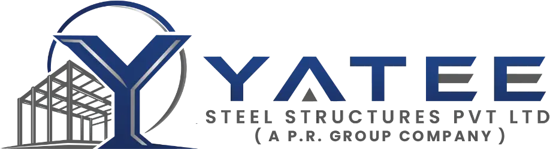

<div align="center">



### Engineering Spaces. Building The Future.

Marketing website for **Yatee Steel Structures Pvt Ltd** (a P.R. Group company),<br/>a pre-engineered building (PEB) and steel structures manufacturer.


**Developed by [Priyabrata Dutta](#-developer)**

</div>

---

## 🏗️ About

Yatee Steel Structures designs, fabricates and erects pre-engineered steel buildings for industrial, warehousing and commercial clients across India.

| | |
|---|---|
| 🏢 **Corporate office** | Indore, Madhya Pradesh |
| 🏭 **Manufacturing plant** | Kadi (Mehsana), Gujarat, 6 acres, 22,000 MT per year |
| 🌐 **Website** | Static, SEO-optimised, 54 pre-rendered pages |

## ✨ Pages

| Section | Routes |
|---|---|
| **Home** | Hero, products, PEB estimator, anatomy, process timeline, projects, insights |
| **About** | Company overview, manufacturing infrastructure, quality and certifications, vision/mission/values, why choose us |
| **Products** | Listing and `/products/[slug]` |
| **Services** | Listing and `/services/[slug]` |
| **Projects** | Completed, ongoing and `/projects/[slug]` |
| **Industries** | Listing and `/industries/[slug]` |
| **News** | Listing and `/news/[slug]` |
| **Careers** | Listing, `/careers/[slug]` and application form |
| **Contact** | Contact page and Get a Quote |

Also generated: `sitemap.xml` and `robots.txt`.

## 🧰 Tech Stack

- **Framework:** [Next.js](https://nextjs.org) 16 (App Router), React 19, TypeScript
- **Styling:** Tailwind CSS 4, clsx, tailwind-merge
- **Motion and icons:** framer-motion, lucide-react, canvas-confetti

> [!WARNING]
> This Next.js version has breaking changes from older releases. Read `AGENTS.md` and `node_modules/next/dist/docs/` before changing framework-level code.

## 🚀 Getting Started

```bash
npm install
npm run dev      # development server  → http://localhost:3000
npm run build    # production build
npm start        # serve the production build
npm run lint     # ESLint
```

## 📁 Project Structure

```
src/
├── app/            routes, layouts, sitemap, robots
├── components/
│   ├── home/       homepage sections
│   ├── layout/     header, mega menu, mobile menu, footer, WhatsApp button
│   ├── ui/         shared primitives (button, accordion, stat counter, ...)
│   ├── shared/     page hero
│   └── careers/    job application form
├── data/           static content (company, products, services, projects, ...)
├── lib/            SEO helpers and utilities
└── types/          shared TypeScript types
public/images/      logos, hero and product images
```

## ✏️ Editing Content

All content is static and lives in `src/data/`. Company details, addresses and plant capacity are in `src/data/company.ts`.

## 🎨 Branding

| Asset | Use |
|---|---|
| `public/images/yatee-logo.webp` | Full-colour logo (header, mobile menu) |
| `public/images/yatee-logo-white.webp` | White logo (footer, dark backgrounds) |

## ☁️ Deployment

Built for [Vercel](https://vercel.com). Any host that runs `npm run build` and `npm start` also works.

## 👨‍💻 Developer

**Priyabrata Dutta**

---

<div align="center">

© Yatee Steel Structures Pvt Ltd. All rights reserved.

</div>
